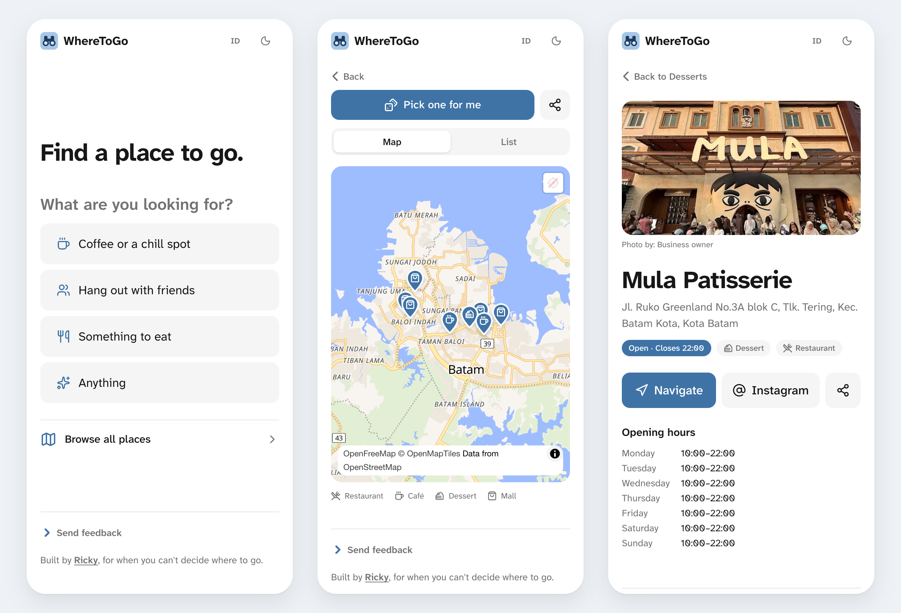

# WhereToGo

Pick a place to go in Batam. Answer three questions (what, from where, when) and see which places are open and how far they are.

**[wheretg.vercel.app](https://wheretg.vercel.app)**



- Map and list of places, with open/closed status at the time you leave
- Start from your location, an area, or a ferry terminal if you arrive from Singapore
- Filter by category, tags, price and distance, or let it pick one for you
- English and Bahasa Indonesia

## Run locally

Needs [Bun](https://bun.sh).

```bash
bun install
bun dev
```

Open http://localhost:3000.

The feedback form sends messages to Telegram. To use it, copy `.env.example` to `.env.local` and fill in the bot token and chat id. Everything else works without it.

## Add a place

Places live in [`src/data/places.json`](src/data/places.json). Photos go in `public/images/places/`.

```json
{
  "id": 10,
  "name": "Example Cafe",
  "categories": ["cafe"],
  "lat": 1.1301,
  "lng": 104.0305,
  "image": "/images/places/10.jpg",
  "address": "Jl. Example No. 1, Batam Kota",
  "hours": { "mon": ["08:00-22:00"], "tue": ["08:00-22:00"] },
  "timezone": "Asia/Jakarta",
  "tags": ["wifi", "work"],
  "price": 1
}
```

Only `id`, `name`, `categories`, `lat` and `lng` are required. A day missing from `hours` means closed that day. The schema in [`src/data/places.ts`](src/data/places.ts) lists every field, and the build fails on a typo or a bad value.

## Scripts

| Command | What it does |
| --- | --- |
| `bun dev` | Dev server |
| `bun run build` | Production build |
| `bun run lint` | Lint and format check (Biome) |
| `bun run check` | Run the `*.check.ts` tests |

## Stack

Next.js, React, Tailwind CSS, MapLibre with OpenFreeMap tiles, zod.
